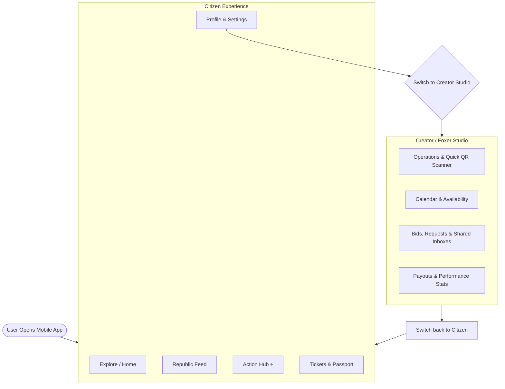

# FoxPassport Mobile — UX Consolidation Strategy & Information Architecture

**Status:** Active  
**Date:** 16 October 2026  
**Context:** Strategic alignment on mobile product direction, resolving feature congestion, and differentiating from Eventbrite.  
**Related Documents:**
* [`foxpassport-feature-audit.md`](./foxpassport-feature-audit.md)
* [`BUSINESS-STRATEGY-MASTER.md`](./BUSINESS-STRATEGY-MASTER.md)

---

## 1. Executive Context & The Problem Statement

> *"Eventbrite mainly helps people discover events and buy tickets, while FoxPassport aims to offer more than that. It gives people a place to discover events, connect with others, find talent, book venues and services, collaborate on projects, and explore investment opportunities.*  
> *...FoxPassport already has a lot of features, so I think our biggest challenge now is figuring out how to bring everything together without making the platform overwhelming for users."*  
> — **RM (Founding Team Discussion, 16 Oct 2026)**

### The Strategic Dilemma
1. **The Eventbrite Gap:** Eventbrite is transactional and static. It facilitates ticket discovery and check-in, but leaves the entire creative, collaborative, and supply chain ecosystem completely unserved.
2. **The FoxPassport Strength:** FoxPassport connects the full experience lifecycle: Citizens, Event Foxers, Venue Mayors, Gear Suppliers, Performers, Organizers, and Investors.
3. **The UX Pitfall ("Feature Congestion"):** Because the backend and web platforms already possess 40+ models and extensive feature sets (bidding, split payouts, shared team inboxes, passport gamification, asset rentals, KYC, affiliations), surfacing everything on mobile simultaneously causes cognitive overload. Users don't know if they are an attendee, an organizer, an equipment renter, or an investor.

---

## 2. Core UX Principle: Progressive Disclosure by Intent

To prevent cognitive fatigue on mobile screens, FoxPassport must adhere to:

> **"Simple on the surface, powerful underneath."**

Instead of building a "dashboard of dashboards", the mobile app must default to the **Citizen Experience** (lightweight, visual, social, and intuitive) and reveal creator/operational complexity **only when requested**.

---

## 3. The Two-Mode Paradigm (Citizen Mode vs. Creator Studio)



### Mode Separation:
* **Citizen Mode (90% of user sessions):**
  * Focuses purely on discovery, community participation, ticket access, and personal achievement.
  * No clutter from inventory tracking, payout configurations, or RFP negotiation tables.
* **Creator Studio (Accessible via Profile or top quick-switch):**
  * Automatically enabled for approved RoleTypes (`eventFoxer`, `venueFoxer`, `gearFoxer`, `serviceFoxer`, `performerFoxer`, `organizer`).
  * Transforms the navigation into operational management tools for day-of event execution and listing management.

---

## 4. The 5-Tab Mobile Architecture (Citizen Mode)

The bottom navigation bar stays strictly anchored to 5 intuitive destinations:

```
[ 🔍 Explore ]  [ 🌐 Republic ]  [ ➕ Create ]  [ 🎟️ Passport & Tickets ]  [ 👤 Profile ]
```

### 1. Tab 1: Explore (Discovery & Map)
* **Location Bar & Radius Picker:** (e.g., *"Manila • 15 km"*).
* **Curated Experience Streams:**
  * *Upcoming Events* (Music, Sports, Community, Dining).
  * *Unique Venues* (Rooftops, Beaches, Warehouses listed by Mayors).
  * *Top Talent & Performers* (DJs, Photographers, Hosts).
* **Interactive Map View:** Toggle button to view local pins, venues, and experiences using Mapbox.

### 2. Tab 2: Republic (The Social & Community Layer)
* **Activity Feed:** Event recaps, behind-the-scenes stories, and announcements from followed organizers and venues.
* **Interactive Community Polls:** Audience voting on event details (e.g., setlists, themes).
* **Connections:** Follow fellow citizens, foxers, and community creators.

### 3. Center Button: `[ + ]` "Make It Happen" (Action Hub)
Tapping the center action button displays a clean 3-choice modal rather than separate complex menus:
1. **Plan an Event:** Guided step-by-step package builder (Select Venue $\rightarrow$ Select Talent $\rightarrow$ Add Gear).
2. **Book Talent or Gear:** Fast shortcut to search equipment or hire a professional.
3. **List Your Space or Skills:** Quick gateway to apply for a Foxer role.

### 4. Tab 3: Passport & Tickets (Personal Activity)
Combines present access with past achievements:
* **Segment A: Active Tickets:** Upcoming event passes with high-brightness QR codes for gate check-in, venue directions, and schedule notices.
* **Segment B: Digital Passport:** Earned stamps, unlocked badge collection, progression paths, and leaderboard ranking.

### 5. Tab 4: Profile & Settings
* Public Citizen profile, verified identity badge, saved wishlists, and account settings.
* **Prominent "Switch to Creator Studio" toggle button** for users holding approved Foxer or Organizer roles.

---

## 5. Creator Studio Navigation (Operational Mode)

When an approved Foxer or Organizer enters Studio mode, the bottom bar shifts to their operational workflow:

1. **Dashboard:** Quick daily summary (Today's check-ins, upcoming bookings, pending inquiries).
2. **Calendar:** Availability manager, conflict resolution warnings, and booking date blocks.
3. **Studio Inbox:**
   * **Direct Messages:** Inquiries from citizens.
   * **Shared Inboxes:** Grouped by Event/Venue, allowing Mayors and appointed Organizers to collaboratively manage guest messages.
4. **Quick QR Scanner:** Dedicated camera scanner for check-in staff at the venue entrance.
5. **Earnings & Return:** Stripe Connect payout balance, recent transaction receipts, and one-tap switch back to Citizen mode.

---

## 6. Web Desktop vs. Mobile App Responsibility Matrix

Attempting to put heavy administrative workflows into a mobile app creates poor usability. The division of labor across platforms should be intentional:

| Workflow / Capability | Mobile App Role | Web Desktop App Role |
| :--- | :--- | :--- |
| **Event Discovery & Ticketing** | **Primary** (Location-aware, QR tickets, digital pass) | Secondary (Web browsing, SEO links) |
| **Community Feed & Gamification** | **Primary** (Push notifications, quick reactions, badges) | Secondary (Read-only feed access) |
| **Door Check-In / Scanning** | **Primary** (Fast camera scanning by Check-in Helpers) | Fallback (Manual guestlist search) |
| **Complex Event Template Assembly** | Light builder (Presets & bundles) | **Primary** (Multi-item line item markup, budget builder) |
| **Detailed RFP & Bidding Tables** | Quick accept/decline notifications | **Primary** (Side-by-side bid comparison, contracts) |
| **Stripe Connect Deep Onboarding** | Deep-link to Stripe web view | **Primary** (Full financial tax/bank verification) |
| **Investor & Partnership Proposals** | Summary card & status check | **Primary** (Legal documentation, cap table review) |

---

## 7. Phased Mobile Delivery Roadmap

To keep Flutter development fast and disciplined, roll out features in progressive milestones:

### Milestone 1: The Core Attendee Loop (Current Focus)
* Clean Authentication (Better Auth, Google/Apple OAuth).
* Explore / Search / Event Details.
* My Tickets (QR Code display for door entry).
* Digital Passport (Stamps & Badges view).

### Milestone 2: Community & Engagement
* Republic Feed (Posts, Polls, Likes, Comments).
* Follow system & Notifications (Socket.IO realtime alerts).
* Review & Rating submission (with booking verification).

### Milestone 3: Mobile Creator Studio (Lightweight Operations)
* One-tap Citizen/Creator switch.
* Mobile Camera QR Scanner for door staff.
* Shared Inboxes & direct chat.
* Availability toggle (mark days busy/free).
